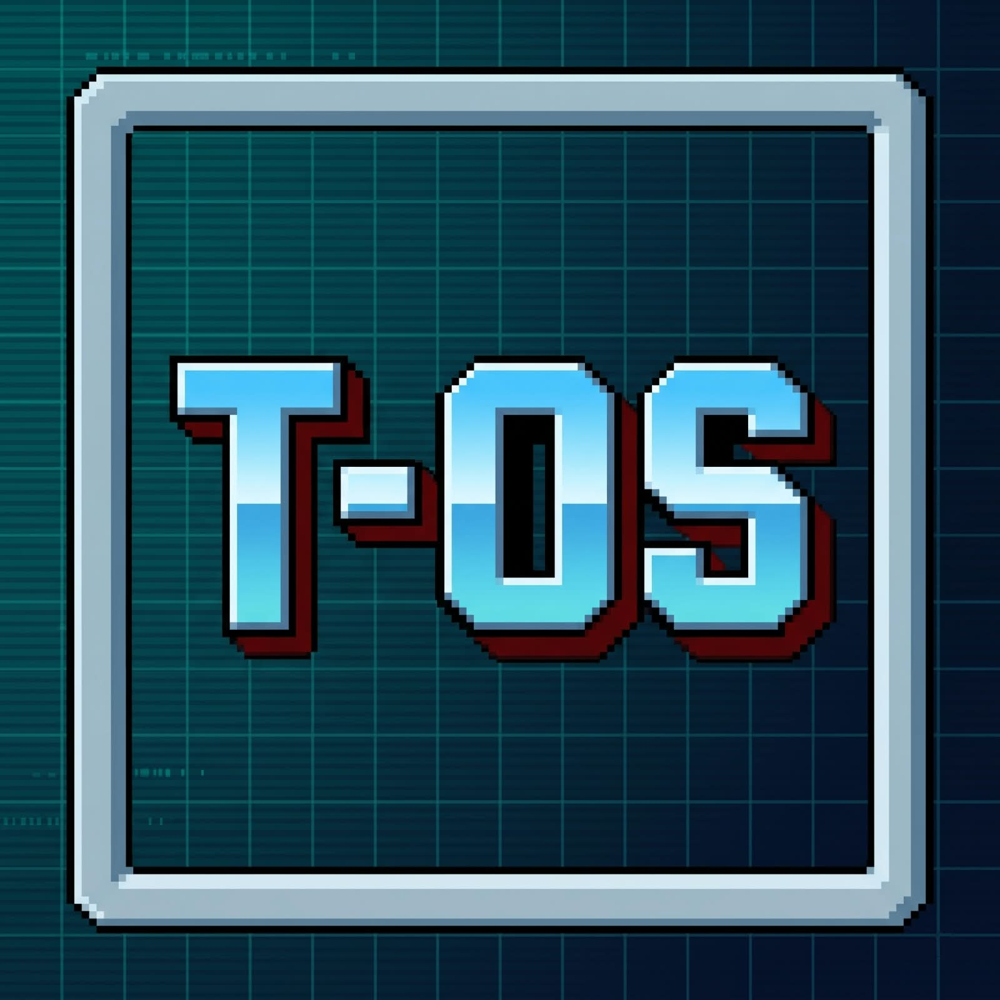
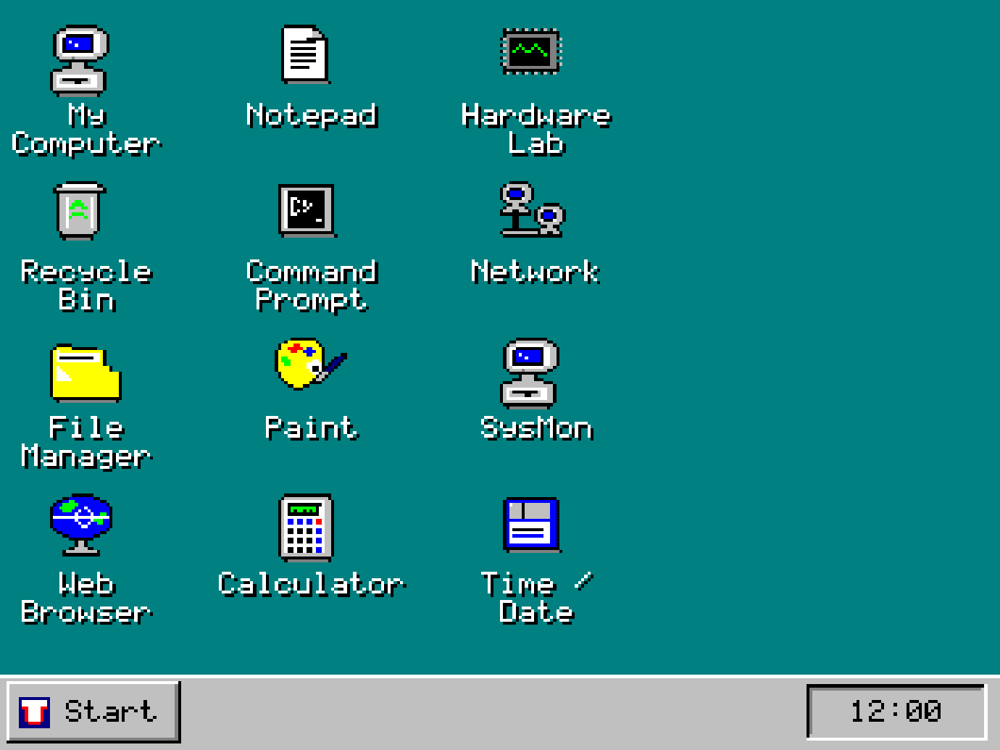
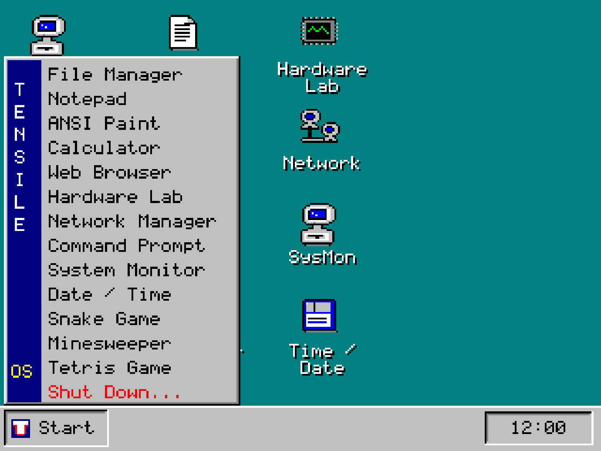
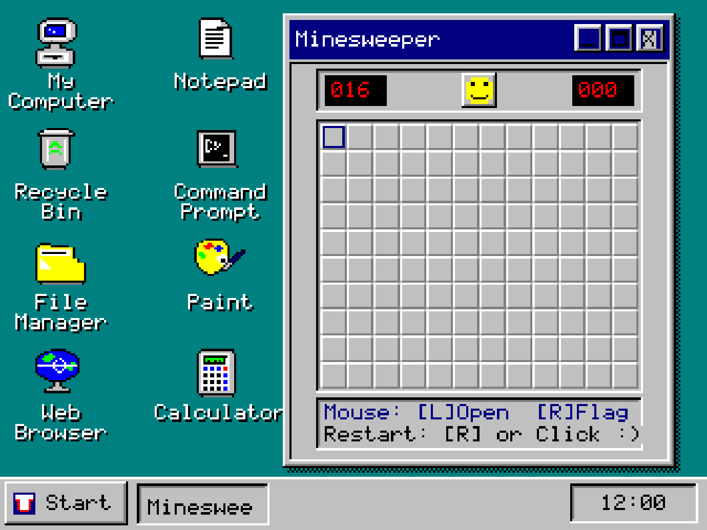
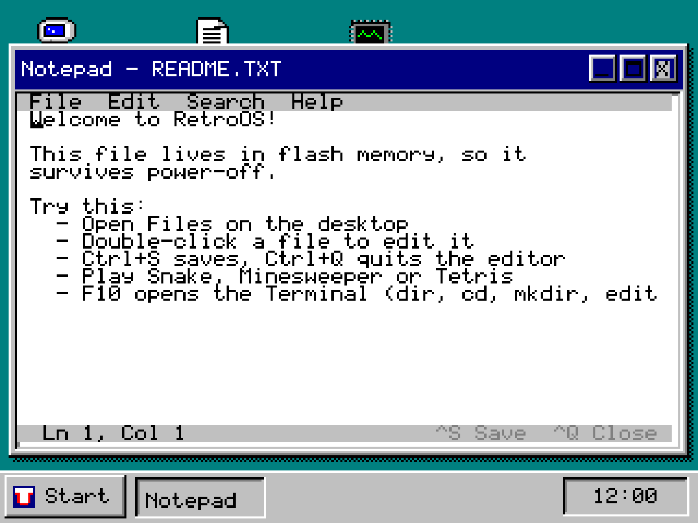

<div align="center">
  <br><br>
  <br>

  <p align="center">
    <strong>The Bare-Metal 32-Bit Retro Desktop Operating System for ESP32</strong><br>
    <em>100% on-chip silicon execution • 320×240 16-color pixel GUI • Streamed in real-time over Wi-Fi</em>
  </p>

  <p align="center">
    <a href="https://www.espressif.com/"></a>
    <a href="LICENSE"></a>
    <a href="CHANGELOG.md"></a>
    
    
  </p>
</div>

---

**TensileOS** is a bare-metal, open-source 32-bit retro desktop operating system executing directly on ESP32 microcontroller silicon. It renders a complete 320×240 16-color pixel GUI with genuine 3D beveled windows, a 17-application workstation suite, and virtual disk storage. The entire graphical desktop streams in real-time over WebSocket to any web browser with zero client installation.

---

## Live Desktop and Screenshot Previews

The screenshots below show TensileOS running on a standard ESP32 development board. The browser acts purely as a thin virtual monitor; all rasterization, windowing logic, and application code execute on the microcontroller.

<div align="center">
  
  <p><em>Multitasking on bare-metal ESP32 silicon: Command Prompt, Notepad, and Minesweeper active simultaneously with live taskbar tabs and real-time clock.</em></p>
</div>

| Clean Desktop with 16-Color Icons | Cascading Start Menu Navigation |
| :---: | :---: |
|  |  |
| **Authentic 90s Desktop**: Classic teal wallpaper, system tray RTC clock, and desktop shortcuts. | **Cascading Start Menu**: Vertical `TENSILE OS` banner organizing applications across categories. |

| Minesweeper Game | Notepad Text Editor |
| :---: | :---: |
|  |  |
| **Minesweeper**: Sunken 3D tiles, digital 7-segment timers, flag placement, and interactive reset smiley. | **Notepad**: Text editor with LittleFS file persistence reading and writing files on Drive `C:\`. |

> [!NOTE]
> These previews show only 4 of the **17 built-in applications and diagnostic tools** bundled with TensileOS. See the [Application Suite Matrix](#complete-17-application-suite-matrix) below and the [Applications Reference Manual](docs/apps-reference.md) for full documentation of every tool.

---

## Core Engineering Principles

* **100% Microcontroller Execution:** TensileOS is neither an emulator nor a remote cloud stream. Every window, line, bevel, font glyph, and game tick is computed on the ESP32 (240 MHz dual-core Tensilica Xtensa LX6) using a custom 4-bit packed raster engine.
* **Strict Memory Footprint:** The 320×240 16-color framebuffer consumes only **38,400 bytes** (2 pixels per byte at 160 bytes per scanline). This leaves over **240 KB of free DRAM** for multitasking applications, network packet queues, and file buffers.
* **Zero Hardware Wiring:** No SPI LCD panels, ribbon cables, or breadboards required. The ESP32 hosts its own Wi-Fi Access Point and WebSocket server, streaming full-frame pixel slices to any laptop, tablet, or phone browser at 60 FPS with local 144 Hz cursor rendering.
* **Dual-Core FreeRTOS Partitioning:** Core 1 drives the 60 Hz OS frame tick and application logic. Core 0 handles the Wi-Fi stack and network slice streaming. Framebuffer locks are held only during memory copies (less than 0.1 ms), preventing network latency from dropping GUI frames.
* **Accelerated SIMD Rasterizer:** Horizontal rectangle spans use 32-bit word-aligned `memset` operations to write 8 pixels per machine cycle. A 200×140 window interior clears in **0.03 ms**, delivering a **116x speedup** over naive pixel-by-pixel loops.

---

## Complete 17-Application Suite Matrix

TensileOS comes fully equipped out of the box with 17 native applications, diagnostics, and tools:

| Category | Application | Binary / ID | Description |
| :--- | :--- | :--- | :--- |
| **Engineering** | **Hardware Lab** | `hwlab` | Dual-trace CRT oscilloscope (ADC 34/35) with calibrated graticule, signal telemetry ($V_{\text{pp}}$, $V_{\text{max}}$, $V_{\text{min}}$), and 6 GPIO logic output switches with on-screen LED indicators. |
| **Diagnostics** | **SysBench** | `sysbench` | Synthetic benchmark testing CPU integer prime sieve, floating-point MFLOPS, RAM bandwidth, LittleFS flash speed, and character rasterizer FPS. |
| **Creative** | **Tensile Paint** | `paint` | 2D pixel-art studio with 210×118 canvas, Pen, Brush, Eraser, Fill, Line tools, 16-color swatches, brush sizing, scanline flood fill, and LittleFS `.DAT` save/load. |
| **Productivity** | **Notepad** | `notepad` | Full-screen text editor reading and editing plain text files (`*.TXT`, `*.BAT`, `*.INI`) directly on Drive `C:\`. |
| **Storage** | **File Manager** | `filemgr` | Dual-pane LittleFS explorer to create, rename, view sizes, open, and delete files on Drive `C:\`. |
| **Mathematics** | **Scientific Calculator** | `calc` | Expression evaluator supporting parentheses, precedence, powers, trigonometry (`sin`, `cos`, `tan`), logarithms (`ln`, `log`), and constants ($\pi$, $e$). |
| **Entertainment** | **TensileDoom** | `doom` | Native 2.5D first-person shooter engine with 192-column DDA raycasting, 16-color distance shading, E1M1 level homage, sliding airlock doors, animated Doomguy HUD face, and Shotgun/Pistol combat. |
| **Entertainment** | **Minesweeper** | `mine` | Classic 3D sunken tile field, 7-segment digital displays, flag toggles, interactive reset smiley button, and WebAudio sounds. |
| **Entertainment** | **Tetris** | `tetris` | 7 standard tetrominoes with 3D light/shadow bevels, score counter, line clear tones, and next piece preview. |
| **Entertainment** | **Snake** | `snake` | 3D beveled snake, food apple, boundary collision detection, sound effects, and persistent high score tracking. |
| **System** | **System Monitor** | `sysmon` | Live visual gauges for dual-core CPU utilization, free heap DRAM, LittleFS partition allocation, and uptime telemetry. |
| **System** | **My Computer** | `mycomp` | Hardware inspector displaying CPU architecture, clock rate, SRAM allocation, and Drive `C:\` storage statistics. |
| **Storage** | **Recycle Bin** | `trash` | File deletion staging directory (`/TRASH`) allowing file inspection, restoration, and secure permanent flash cleanup. |
| **Configuration** | **Date & Time** | `timeset` | Interactive property dialog with analog clock face and numeric adjusters to set the real-time software clock. |
| **Shell** | **Command Prompt** | `cmd` | Command interpreter inside a window supporting built-in commands (`DIR`, `MEM`, `TIME`, `VER`, `CLS`, `HELP`, `REBOOT`). |
| **Scripting** | **Batch Script Runner** | System | Automatically executes `/AUTOEXEC.BAT` from LittleFS root at boot before loading the graphical window manager. |
| **Network** | **Network Suite** | `netmgr` / `browser` | Wireless network manager for 802.11 b/g/n scanning plus RetroWeb text browser for viewing local and web documents. |

For detailed documentation, controls, and technical parameters for every application, refer to the [Applications Reference Manual](docs/apps-reference.md).

---

## Hardware Specifications

TensileOS requires an Espressif ESP32 development board with standard dual-core silicon and 4 MB Flash.

| Component | Specification | Details |
| :--- | :--- | :--- |
| **Target MCU** | ESP32-D0WD-V3, ESP32-WROOM-32, NodeMCU-32S | Dual-core Tensilica Xtensa LX6 @ 240 MHz |
| **Display** | None (Virtual Display over Wi-Fi) | Viewable on any browser (Chrome, Edge, Safari, Firefox) |
| **SRAM** | 520 KB Total (~320 KB usable heap) | Framebuffer uses 38.4 KB; >240 KB remains for apps |
| **Flash Partition** | 4 MB Flash (`Huge APP` partition scheme) | 3.14 MB firmware, LittleFS mounted at Drive `C:\` |
| **Oscilloscope In** | GPIO 34 (ADC1_CH6) and GPIO 35 (ADC1_CH7) | 0.0V to 3.3V analog input, fully safe with active Wi-Fi |
| **Logic Outputs** | GPIO 2, 4, 18, 19, 21, 22 | Controllable via Hardware Lab with live LED feedback |

---

## Quick Start Guide

### Step 1: Toolchain Installation
* Install [Arduino IDE 2.x](https://www.arduino.cc/en/software) or [arduino-cli](https://arduino.github.io/arduino-cli/).
* Install the ESP32 core (`esp32:esp32` version 2.0.6 or newer; version 3.x is fully supported).

### Step 2: Clone the Repository
```bash
git clone https://github.com/siddharth-fr/TensileOS.git
cd TensileOS
```

### Step 3: Compile and Flash

* **Using Arduino IDE:**
  1. Open `tensileos/tensileos.ino`.
  2. Select your board (for example, **ESP32 Dev Module**).
  3. Under **Tools -> Partition Scheme**, select **Huge APP (3MB No OTA/1MB SPIFFS)**.
  4. Select your serial port and click **Upload**.

* **Using `arduino-cli`:**
```powershell
arduino-cli compile --fqbn esp32:esp32:esp32:PartitionScheme=huge_app tensileos
arduino-cli upload -p COM8 --fqbn esp32:esp32:esp32:PartitionScheme=huge_app tensileos
```
*(Replace `COM8` with your board's serial port).*

### Step 4: Connect to the Desktop
1. On your PC, tablet, or phone, connect to the Wi-Fi hotspot:
   * **SSID:** `TensileOS`
   * **Password:** `tensile123`
2. Open your browser and navigate to:
   ```
   http://192.168.4.1/
   ```
3. The desktop will load immediately at 320×240 pixel resolution accompanied by the startup chime.

*(To join your home Wi-Fi instead of running a standalone hotspot, set your network credentials in `tensileos/config/config.h` and navigate to `http://tensileos.local/`).*

---

## Controls and Usage

### Mouse and Desktop Navigation
* **Left Click:** Open apps, focus windows, drag titlebars, press buttons, paint with Foreground color.
* **Right Click:** Erase with Background color in Paint, toggle flags in Minesweeper.
* **60 FPS Wireframe Ghost Dragging:** Click and hold any window titlebar to move the fast dithered outline without redrawing background windows. Release to snap the window into its new position.

### Command Prompt Reference
| Command | Description | Example |
| :--- | :--- | :--- |
| `HELP` or `?` | Lists all available built-in commands | `C:\> HELP` |
| `DIR` | Lists files and directories on Drive `C:\` | `C:\> DIR` |
| `MEM` | Displays total and available FreeRTOS heap memory | `C:\> MEM` |
| `VER` | Prints TensileOS operating system version | `C:\> VER` |
| `TIME` | Displays or sets the system real-time clock | `C:\> TIME 14:30` |
| `CLS` | Clears the command prompt terminal buffer | `C:\> CLS` |
| `REBOOT` | Triggers a hardware restart of the ESP32 | `C:\> REBOOT` |

See the [CLI Reference](docs/cli-reference.md) for complete command options and batch script syntax.

---

## Repository Structure

```
TensileOS/
├── tensileos/               # Firmware source root
│   ├── tensileos.ino        # Bootloader and FreeRTOS dual-core task pinning
│   ├── config/              # Wi-Fi credentials, OS version, and pin assignments
│   ├── core/                # Input handling, sound synthesizer, base UI interfaces
│   ├── display/             # 4-bit rasterizer, Window Manager, sprites, screensaver
│   ├── fs/                  # LittleFS virtual disk (Drive C:\) and AUTOEXEC.BAT
│   ├── net/                 # Wi-Fi AP/STA and WebSocket streaming server
│   ├── shell/               # Command Prompt interpreter and Notepad text editor
│   ├── apps/                # Paint, Hardware Lab, SysBench, File Manager, Calculator
│   └── games/               # Minesweeper, Tetris, and Snake
├── docs/                    # Technical documentation
│   ├── assets/              # Banners, logos, and screenshots
│   ├── apps-reference.md    # Complete 16-application technical manual
│   ├── architecture.md      # Dual-core architecture and memory allocation maps
│   ├── getting-started.md   # Step-by-step setup and flashing guide
│   ├── cli-reference.md     # Command prompt syntax and batch scripting
│   ├── development-guide.md # Tutorial for authoring new apps and tools
│   ├── hardware.md          # Pinout diagrams, ADC rules, and logic wiring
│   ├── troubleshooting.md   # Diagnostic guide for flash, serial, and Wi-Fi
│   └── faq.md               # Frequently asked technical questions
├── .github/                 # GitHub Actions CI workflow and issue templates
├── CHANGELOG.md             # Semantic Versioning release history
├── CONTRIBUTING.md          # Contribution guidelines and coding conventions
├── CODE_OF_CONDUCT.md       # Community guidelines
├── LICENSE                  # MIT License
└── README.md                # Project overview and documentation entry point
```

---

## Roadmap

- [x] Native 320×240 16-color 4-bit packed framebuffer
- [x] Desktop Window Manager with 3D bevels and window controls
- [x] 60 FPS wireframe ghost dragging with dithered houndstooth outline
- [x] Turbo rasterizer with SIMD `memset` row fills (116x speedup)
- [x] Hardware Lab Virtual CRT Oscilloscope with ADC 34/35 and GPIO output switches
- [x] Tensile Paint with 16-color palette swatches and scanline flood fill
- [x] Full suite of 17 native applications, games, and system tools
- [x] Native 2.5D TensileDoom FPS engine with E1M1 map, weapons, and combat AI
- [x] Fine-grained dirty tracking (Taskbar redraw uses only 3.8 KB instead of 38.4 KB)
- [x] Coalesced WebSocket streaming (maximum 2 packets per frame)
- [ ] Sound card emulation and MIDI audio playback engine
- [ ] Drag-and-drop file operations between desktop and applications
- [ ] Virtual floppy disk image mounting (`.IMG`) for Drive `A:\`
- [ ] Parallel hardware SPI display driver option (ILI9341 / ST7789)

---

## Contributing

Contributions are welcome. Please read [CONTRIBUTING.md](CONTRIBUTING.md) for code style guidelines, FreeRTOS task safety practices, and the pull request workflow.

---

## License

TensileOS is open-source software released under the [MIT License](LICENSE).

---

## Acknowledgements

* **Espressif Systems** for the ESP32 microcontroller and the ESP-IDF HTTP server framework.
* **The pioneer engineers and designers** of the classic 1990s personal computer era for foundational user interface paradigms.
* **IBM PC / CP437** for the classic retro monospace typography.
