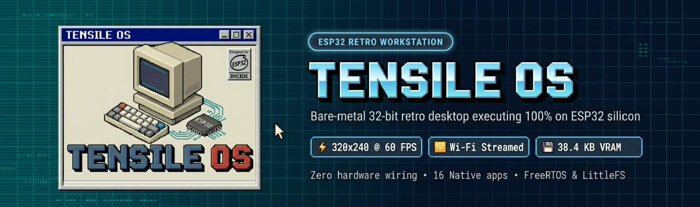
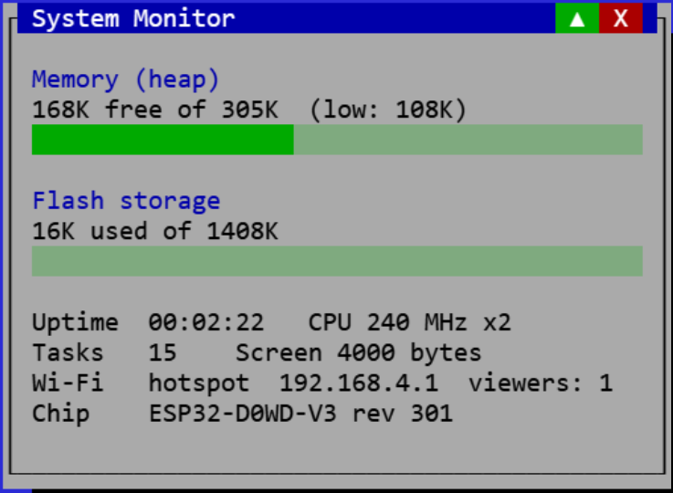

<div align="center">
  <br><br>
  <br>

  <p align="center">
    <strong>The Bare-Metal 32-Bit Retro Desktop Operating System for ESP32</strong><br>
    <em>100% on-chip silicon execution • 320×240 16-color pixel GUI • Streamed in real-time over Wi-Fi</em>
  </p>

  <p align="center">
    <a href="https://www.espressif.com/"></a>
    <a href="LICENSE"></a>
    <a href="CHANGELOG.md"></a>
    
    
  </p>
</div>

---

> **TensileOS** is a bare-metal, open-source 32-bit retro desktop operating system executing 100% on ESP32 microcontroller silicon. It renders a complete 320×240 16-color pixel GUI with genuine 3D beveled windows, multitasking apps, and virtual disk storage—streamed in real-time over WebSocket to any web browser with zero client installation.

---

## 📸 Live Desktop & Previews

<div align="center">
  
  <p><em>Live 320×240 16-color pixel desktop with authentic 3D beveled windows, System Monitor, and Command Prompt streaming over Wi-Fi at 60 FPS.</em></p>
</div>

---

## 💡 Why This Exists

* **Not an Emulator, Not a Cloud Stream:** Every pixel, line, bevel, window, and application is computed on bare-metal ESP32 silicon (240 MHz Tensilica Xtensa dual-core) using a custom 4-bit packed 2D raster engine.
* **Extreme Memory Stewardship:** Consumes just **38,400 bytes** for its 320×240 16-color framebuffer (2 pixels per byte), leaving over **240 KB of free heap** for file caching, audio queues, and multitasking applications.
* **Zero Hardware Wiring:** No SPI TFT screens, ribbon cables, or breadboards required. The ESP32 hosts its own Wi-Fi Access Point and WebSocket server, streaming full-frame pixel slices to any smartphone, tablet, or PC browser at 60 FPS with local 144 Hz cursor rendering.
* **Authentic 1990s Experience:** True 2-pixel 3D light/shadow bevels, classic 16-color palette, icons, start menu, system tray clock, PC speaker square-wave chimes, and retro wireframe window dragging.

---

## ✨ Features

### 🪟 TensileOS Desktop & Window Manager
* **Authentic 3D Beveled Windows:** Active (navy) and inactive (grey) titlebars with minimize, maximize/restore, and close buttons.
* **60 FPS Wireframe Ghost Dragging:** Iconic 1-pixel dithered houndstooth wireframe outline tracks cursor movements with zero app lag, snapping into place on release.
* **Taskbar & Start Menu:** 14-item cascading Start Menu with vertical `TENSILE OS` banner, sunken system tray clock, and active taskbar tabs with anti-overlap truncation.
* **Fine-Grained Dirty Tracking:** Isolated taskbar clock redraws (3.8 KB instead of 38.4 KB — 90% bandwidth reduction) and window-level client updates.
* **Desktop Background Caching:** Pre-rendered teal background and desktop icons blitted via instantaneous `memcpy`.

### 🎨 Built-in Applications & Tools
1. **TensileOS 2D Pixel Paint:** 210×118 4-bit packed canvas, tool palette (Pen, Brush, Eraser, Fill, Line), 16-color palette swatches, brush sizing, scanline flood fill, and LittleFS `.DAT` file save/load.
2. **Hardware Lab (Oscilloscope & Logic Analyzer):** Real-time CRT phosphor oscilloscope with 6 signal sources (ADC 34, ADC 35, Sine 1kHz, Square, Triangle, ECG Cardiac), digital measurement panel (Vpp, Vmax, Vmin), and 6 digital GPIO output switches with virtual LED indicators.
3. **SysBench:** Synthetic hardware benchmark suite measuring CPU integer sieve performance, floating-point MFLOPS, 32-bit RAM bandwidth, LittleFS flash speed, and text render FPS.
4. **Minesweeper:** Authentic sunken playfield, interactive yellow smiley face reset button, 7-segment digital mine and timer displays, 3D flags, and unrevealed bevel tiles.
5. **Snake & Tetris:** Re-engineered with native 16-color pixel graphics, 3D beveled blocks, high scores, and sound effects.
6. **File Manager:** Dual-pane browser for virtual Drive `C:\` (open, create file/folder, rename, delete, view file sizes).
7. **Scientific Calculator:** Expression parser supporting operator precedence, parentheses, trigonometry (`sin`, `cos`, `tan`), logarithms (`ln`, `log`), powers, and constants (`pi`, `e`).
8. **Command Prompt:** Interactive terminal inside a window with built-in commands (`DIR`, `MEM`, `TIME`, `VER`, `CLS`, `HELP`, `REBOOT`).
9. **Notepad Text Editor:** Full-screen editor with keyboard navigation and LittleFS read/write.
10. **System Monitor:** Real-time dual-core CPU load, free heap memory bar, LittleFS flash gauge, uptime, and Wi-Fi metrics.
11. **My Computer & Recycle Bin:** Drive capacity inspector and safe file deletion staging (`/TRASH`).
12. **Date & Time Properties:** Interactive real-time clock adjustment dialog.
13. **RetroWeb:** Lightweight text-mode HTML browser with Lynx-style layout.
14. **Network Manager:** Live Wi-Fi network scanner and connection utility.

---

## 🔌 Hardware Requirements

| Component | Requirement | Notes |
| :--- | :--- | :--- |
| **Microcontroller** | ESP32-D0WD-V3, ESP32-WROOM-32, NodeMCU-32S | Standard dual-core @ 240 MHz with 4 MB Flash. |
| **Display** | None (Virtual Display over Wi-Fi) | Viewable on any browser (Chrome, Edge, Safari, Firefox). |
| **Oscilloscope Probe** | GPIO 34 (ADC1_CH6) or GPIO 35 (ADC1_CH7) | Analog input (0–3.3V). Safe with active Wi-Fi. |
| **Logic Outputs** | GPIO 2, 4, 18, 19, 21, 22 | Controllable via Hardware Lab with LED indicators. |

---

## 🚀 Quick Start Guide

### Step 1: Prerequisites
* Install [Arduino IDE 2.x](https://www.arduino.cc/en/software) or [arduino-cli](https://arduino.github.io/arduino-cli/).
* Install the ESP32 Arduino Core (`esp32:esp32` version 2.0.6 or newer; version 3.x supported).

### Step 2: Clone & Open
```bash
git clone https://github.com/siddharth-fr/TensileOS.git
cd TensileOS
```

### Step 3: Build & Flash
* **In Arduino IDE:**
  1. Open `tensileos/tensileos.ino`.
  2. Select your board (e.g. **ESP32 Dev Module**).
  3. Under **Tools → Partition Scheme**, select **Huge APP (3MB No OTA/1MB SPIFFS)**.
  4. Select your COM Port and click **Upload**.

* **Or with `arduino-cli`:**
```powershell
arduino-cli compile --fqbn esp32:esp32:esp32:PartitionScheme=huge_app tensileos
arduino-cli upload -p COM8 --fqbn esp32:esp32:esp32:PartitionScheme=huge_app tensileos
```

### Step 4: Connect & Enjoy
1. On your laptop, phone, or tablet, connect to the Wi-Fi hotspot:
   * **SSID:** `TensileOS`
   * **Password:** `tensile123`
2. Open your web browser and navigate to:
   ```
   http://192.168.4.1/
   ```
   *(If connected to home Wi-Fi via `config.h`, navigate to `http://tensileos.local/`)*

---

## ⌨️ Controls & Usage

### Desktop & Mouse
* **Left Click:** Open apps, focus windows, drag titlebars, press buttons, paint with Foreground color.
* **Right Click:** Erase with Background color in Paint, place/remove flags in Minesweeper.
* **Window Dragging:** Click and hold any window titlebar to move the fast wireframe ghost outline. Release to snap.

### Command Prompt CLI Reference
| Command | Description | Example |
| :--- | :--- | :--- |
| `HELP` or `?` | Lists all available built-in commands | `C:\> HELP` |
| `DIR` | Lists all files and directories on Drive `C:\` | `C:\> DIR` |
| `MEM` | Displays total and free heap memory in KB | `C:\> MEM` |
| `VER` | Prints TensileOS version information | `C:\> VER` |
| `TIME` | Displays or sets the system real-time clock | `C:\> TIME 14:30` |
| `CLS` | Clears the command prompt screen | `C:\> CLS` |
| `REBOOT` | Restarts the ESP32 hardware | `C:\> REBOOT` |

### Games Controls
* **Minesweeper:** `Left Click` reveals tile; `Right Click` toggles flag; click `[:)]` or press `R` to restart.
* **Snake:** `Arrow Keys` or `WASD` to steer; `P` to pause; `R` to restart.
* **Tetris:** `Left/Right Arrows` to move; `Up Arrow` to rotate; `Space` to hard drop; `Down Arrow` for soft drop.

---

## 📂 Project Structure

```
TensileOS/
├── tensileos/               # Arduino firmware root
│   ├── tensileos.ino        # Bootloader & dual-core FreeRTOS task pinning
│   ├── config/              # Wi-Fi credentials, OS name, version, and pins
│   ├── core/                # Input, sound synthesizer, base UI interfaces
│   ├── display/             # 320x240 rasterizer, Window Manager, sprites, screensaver
│   ├── fs/                  # LittleFS virtual disk (Drive C:\) & AUTOEXEC.BAT
│   ├── net/                 # Wi-Fi AP/STA, WebSocket virtual monitor server
│   ├── shell/               # Command Prompt and Notepad text editor
│   ├── apps/                # Paint, Hardware Lab, SysBench, File Manager, Calculator
│   └── games/               # Minesweeper, Tetris, and Snake
├── docs/                    # Technical documentation
│   ├── assets/              # SVG banners, logos, and preview screenshots
│   ├── architecture.md      # Dual-core architecture & memory maps
│   ├── getting-started.md   # Setup, flashing, and connection guide
│   ├── cli-reference.md     # Command prompt syntax & examples
│   ├── development-guide.md # How to author new apps and drivers
│   ├── hardware.md          # Pinouts, ADC safety, and wiring
│   ├── troubleshooting.md   # Flash overflow, COM port, and connection fixes
│   └── faq.md               # Frequently asked technical questions
├── .github/                 # GitHub Actions CI workflow & issue templates
├── CHANGELOG.md             # Semantic Versioning release history
├── CONTRIBUTING.md          # Contribution guidelines & coding conventions
├── CODE_OF_CONDUCT.md       # Community collaboration guidelines
├── LICENSE                  # MIT License
└── README.md                # Main project showcase
```

---

## ⚙️ Configuration

All user settings are located in [`tensileos/config/config.h`](tensileos/config/config.h):
* **Join Home Wi-Fi (Station Mode):**
  ```cpp
  #define WIFI_STA_SSID "YourWiFiNetwork"
  #define WIFI_STA_PASS "YourWiFiPassword"
  ```
* **Hotspot Settings (AP Mode):**
  ```cpp
  #define AP_SSID       "TensileOS"
  #define AP_PASS       "tensile123"
  ```
* **Network Hostname:**
  ```cpp
  #define HOSTNAME      "tensileos" // http://tensileos.local/
  ```

---

## 🗺️ Roadmap
- [x] Native 320×240 16-color 4-bit packed framebuffer
- [x] TensileOS Desktop Window Manager with 3D bevels
- [x] Instantaneous 60 FPS wireframe ghost dragging
- [x] Turbo rasterizer with SIMD `memset` row fills (116× speedup)
- [x] Hardware Lab Virtual CRT Oscilloscope with ADC 34/35 & GPIO switches
- [x] TensileOS 2D Pixel Paint with palette swatches & flood fill
- [x] Minesweeper, Tetris, Snake with native pixel graphics
- [x] Fine-grained dirty rects (Taskbar 90% bandwidth drop)
- [x] Coalesced WebSocket streaming (2 packets/frame max, zero drops)
- [ ] Sound card emulation / MIDI file playback engine
- [ ] Drag-and-drop file support between desktop and applications
- [ ] Virtual floppy disk (.IMG) image mounter for Drive `A:\`
- [ ] Parallel hardware SPI display driver (ILI9341 / ST7789)

---

## 🤝 Contributing
Contributions are warmly welcomed! Please read [CONTRIBUTING.md](CONTRIBUTING.md) for code style guidelines, FreeRTOS task safety practices, and the pull request process. Also review our [CODE_OF_CONDUCT.md](CODE_OF_CONDUCT.md).

---

## 📄 License
TensileOS is released under the permissive [MIT License](LICENSE).

---

## 🙏 Acknowledgements
* **Espressif Systems** for the ESP32 microcontroller and ESP-IDF HTTP server framework.
* **The pioneer engineers and designers** of the classic 1990s desktop computing era for timeless interface ergonomics.
* **IBM PC / CP437** for the classic retro monospace typography.
